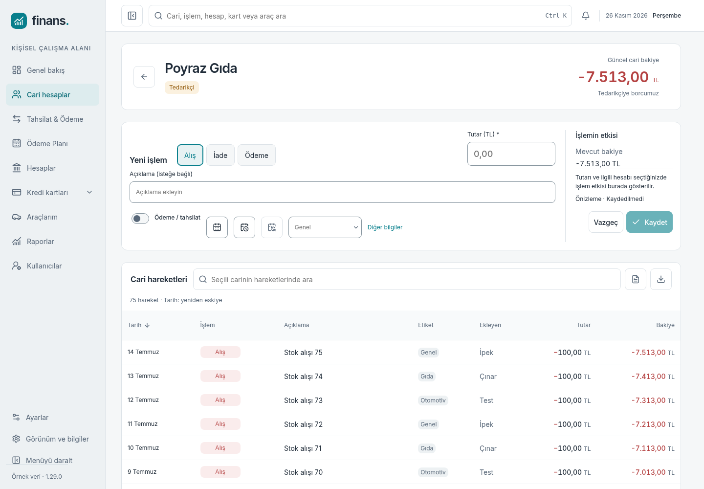
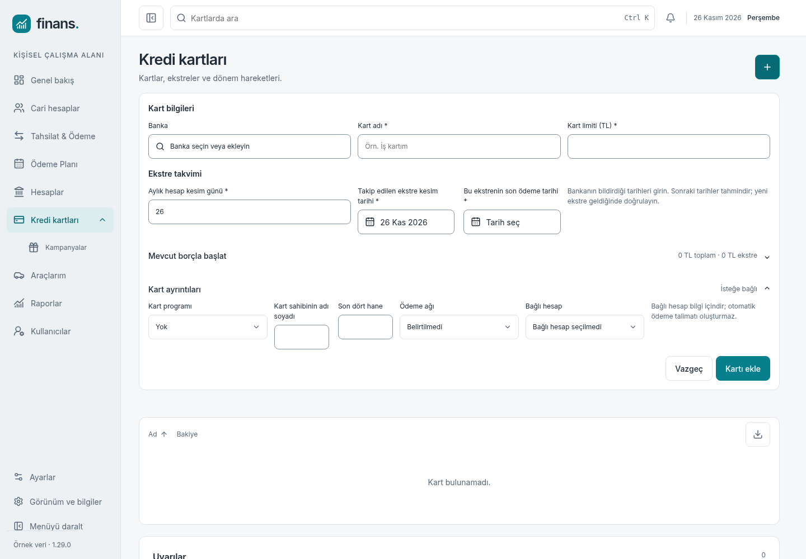
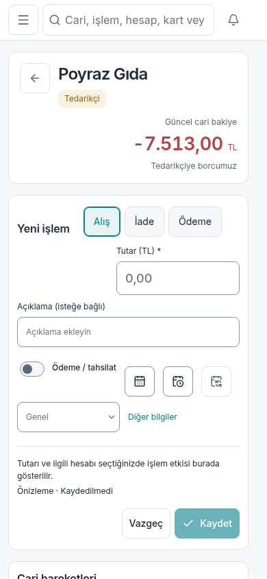

# Sade Netlik — ekran envanteri ve tutarlılık incelemesi

26 Kasım 2026. İnceleme kapsamı: yerel 1.29.0 derlenmiş arayüz; mevcut sentetik UI fixture'ından türetilen, yalnız bu inceleme için kullanılan yerel API. Canlı hosting, gerçek kayıt ve kullanıcı bilgileri kullanılmadı. Uygulama kodu değiştirilmedi. Radix UI henüz bağımlılıklarda bulunmuyor; son taslak uygulanmış sayılmaz.

Chromium ile 1440 × 1000 masaüstü ve iki örnekte 390 × 844 mobil yakalandı. Görüntüler bu incelemede yeniden alındı ve tek tek açılarak incelendi. Fixture tarihi 26 Kasım 2026 olarak ayarlandı. Tutarlar sentetiktir; genel bakış/rapor fixture'ı hesaplama doğrulaması için kullanılmaz. İşlemler kaydedilmedi. Bu belge görsel ve kaynak incelemesidir; tam uçtan uca veya erişilebilirlik sertifikası değildir.

## Genel sonuç

Ürünün bir görsel temeli var: Inter, Lucide, porselen/beyaz yüzey, turkuaz vurgu ve ortak AppShell birçok bölümde tutarlı. Eksik olan, bu temeli tüm ekranlarda zorunlu kılan bileşen ve yerleşim sözleşmesi. Özellikle formlar, boş durumlar, eylem adları ve etiket/kontrol hizaları farklılaşıyor. Yeni bir paletten önce mevcut kuralların uygulanması ve geçerli belgelerin tekleştirilmesi gerekiyor.

Önceki görüşmedeki bir düzeltme: 44 px ana kontrol yüksekliği, 8 px kontrol köşesi ve boşluk ölçeği yalnız yeni öneriler değildir; TASARIM-ILKELERI.md ve tokens.css içinde zaten tanımlıdır. 26 Kasım önerisi bunları yeni forma tutarlı uygulamaktır. Eski belgelerdeki modal, alt işlem alanı ve sütun sırası maddeleri ise sonraki kararlardan ayıklanmadan güncel talimat gibi okunmamalıdır.

## Yakalama adımları ve ekran envanteri

| Adım | Ekran/durum                   | Genel durum                                                                | Kanıt                                                              |
| ---- | ----------------------------- | -------------------------------------------------------------------------- | ------------------------------------------------------------------ |
| 01   | Genel bakış                   | Kabuk tutarlı; boş grafik fazla yüksek                                     | [Görüntü](evidence/design-audit-2026-11-26/01-overview.png)        |
| 02   | Cari listesi                  | Tablo ve özet tanınabilir; genişlik daralınca yardımcı içerik alta geçiyor | [Görüntü](evidence/design-audit-2026-11-26/02-parties.png)         |
| 03   | Tedarikçi detayı, form kapalı | Kimlik ve liste ayrımı açık                                                | [Görüntü](evidence/design-audit-2026-11-26/03-supplier.png)        |
| 04   | Tedarikçi Alış formu          | Başlık/tutar/yardımcı kontroller ortak hatta oturmuyor                     | [Görüntü](evidence/design-audit-2026-11-26/04-supplier-form.png)   |
| 05   | Aynı form, mobil              | Alanlar erişilebilir; form listeyi ilk ekran dışına itiyor                 | [Görüntü](evidence/design-audit-2026-11-26/05-supplier-mobile.png) |
| 06   | Müşteri detayı                | Cari kimlik dili tutarlı; boş liste ayrı yüksek blok                       | [Görüntü](evidence/design-audit-2026-11-26/06-customer.png)        |
| 07   | Müşteri Satış formu           | Tedarikçiyle ortak kusurlar tekrarlanıyor                                  | [Görüntü](evidence/design-audit-2026-11-26/07-customer-form.png)   |
| 08   | Personel detayı               | Aynı kimlik/bilgi kartı dili korunmuş                                      | [Görüntü](evidence/design-audit-2026-11-26/08-staff.png)           |
| 09   | Personel Ödeme formu          | Kaynak/amaç ilişkisi doğru; başlık/tutar hizası sorunlu                    | [Görüntü](evidence/design-audit-2026-11-26/09-staff-form.png)      |
| 10   | Hesap listesi                 | Özet okunur; boş Uyarılar ve Son işlemler alanları büyük                   | [Görüntü](evidence/design-audit-2026-11-26/10-accounts.png)        |
| 11   | Yeni hesap                    | Kontrol yüksekliği tutarlı; cari formundan farklı bölüm/eylem düzeni       | [Görüntü](evidence/design-audit-2026-11-26/11-accounts-form.png)   |
| 12   | Yeni hesap, mobil             | Alanlar sığıyor; dört alan tamamen dikey yığılıyor                         | [Görüntü](evidence/design-audit-2026-11-26/12-accounts-mobile.png) |
| 13   | Kart listesi, boş             | Boş liste/uyarı/son işlem üç ayrı yüzey olarak fazla yer tutuyor           | [Görüntü](evidence/design-audit-2026-11-26/13-cards.png)           |
| 14   | Yeni kart                     | Uzun etiketler ve kısa alanların oranları düzeni bozuyor                   | [Görüntü](evidence/design-audit-2026-11-26/14-cards-form.png)      |
| 15   | Araç listesi, boş             | Diğer boş listelerden farklı yükseklik; üstte ek çizgi                     | [Görüntü](evidence/design-audit-2026-11-26/15-vehicles.png)        |
| 16   | Yeni araç                     | Kısa/uzun veriye göre sütun payları yetersiz                               | [Görüntü](evidence/design-audit-2026-11-26/16-vehicles-form.png)   |
| 17   | Raporlar                      | Ortak yüzey dili var; tarih çipi teknik formatta, boş grafik boyu farklı   | [Görüntü](evidence/design-audit-2026-11-26/17-reports.png)         |
| 18   | Ödeme Planı                   | Takvim farklı amaç taşıyor; özet grubunda boş hücre ve yüksek blok var     | [Görüntü](evidence/design-audit-2026-11-26/18-plan.png)            |

## Bulgular ve öncelikler

### A1 — Öncelik 1: Geçerli tasarım belgesi belirsizleşmiş

Kaynak kanıtı: TASARIM-ILKELERI.md merkez/blur işlem penceresi, eski cari sütun sırası ve başlık oku gibi tarihsel kuralları hâlâ başta sunuyor. GLOBAL-YERLESIM-SOZLESMESI.md alt hızlı işlem ve mobil alt gezinme tarihçesini taşıyor. AGENTS.md sonraki kararları açıklıyor; yeni uygulayıcı doğru kararı birkaç belgeden birleştirmek zorunda.

Öneri: güncel ilkeleri tek kısa sözleşmede tutmak; eski kuralları tarihçe olarak ayırmak. Her kararın kapsamı, istisnası ve yerine geçen karar açık olmalı. Tarihsel kayıt silinmemeli. Bu inceleme belgeleri kendiliğinden yeniden yazmaz.

### A2 — Öncelik 1: Form alanları ortak etiket/kontrol hattını paylaşmıyor

Kanıt: adım 04/07/09'da başlık düğmelerin altına yaslanıyor; tutar ayrı üst etiketiyle bağımsızlaşıyor. Adım 14'te iki satıra dönen kart sahibi ve tarih etiketleri kontrollerin üst kenarlarını ayrıştırıyor. Aynı 44 px yükseklik tek başına hizalama sağlamıyor.

Kaynak: transaction-heading alt hizalı flex; SelectControl hem native hem modern sunum destekliyor; farklı formlarda farklı seçim yolları var. CSS katmanları aynı formu birden çok yerde yeniden biçimlendiriyor.

Öneri: ortak Field/FieldRow; etiket, kontrol, yardım ve hata için ayrı satır rolleri. Uzun etiket geldiğinde aynı gruptaki kontrol hattı korunmalı. Yeni seçilen Açıklama → Etiket → Tutar sırası ortak form ızgarasında uygulanmalı. Radix etkileşim temelini sağlayabilir; geometriyi kendisi çözmez.

### A3 — Öncelik 1: Alan genişlikleri verinin anlamına göre seçilmiyor

Kanıt: adım 14'te kart sahibinin adı ve son dört hane dar; adım 16'da model yılı marka/model kadar yer kaplıyor, kilometre sonraki satırda tek kalıyor. Adım 04'te açıklama tüm satırı tüketiyor.

Öneri: kısa sayı/tarih, tutar, normal metin, uzun metin ve kaynak seçimi için ortak genişlik rolleri. Her form aynı sütun sayısına zorlanmamalı. Sığmayan alan anlamlı bir grup halinde sonraki satıra geçmeli.

### A4 — Öncelik 1: Mobil yoğunluk ayrı tasarım gerektiriyor

Kanıt: adım 05'te kimlik kartı yaklaşık 192 px, açık form yaklaşık 518 px; 844 px viewport'ta hareket listesinin yalnız başlangıcı görünüyor. Adım 12'de dört alan ve ek bölüm başlığı yaklaşık 487 px form oluşturuyor. Bu iki farklı görevin zorunlu alan sayısı farklı; yükseklikleri eşitlemek doğru değil.

Öneri: mobil kimliği kısaltmak; kısa alanları uygun çiftler halinde düzenlemek; yardım/önizleme tekrarlarını azaltmak. Sadece yatay taşma kontrolü kabul için yeterli olmamalı. Yazı/dokunma hedefi küçültmeden kritik işlemin kaç kaydırma gerektirdiği ölçülmeli.

### B1 — Öncelik 2: Boş durumlar gereksiz yüksek ve birbirinden farklı

Kanıt: adım 01'de hareket olmayan grafik yaklaşık 520 px; adım 17'de benzer boş grafik yaklaşık 180 px. Adım 10/13'te sıfır uyarı büyük panel ve Tümünü göster (0) eylemiyle yer tutuyor. Araç boş listesi daha kısa.

Öneri: ortak EmptyState; liste, grafik ve uyarı için tanımlı kompakt varyantlar. Boş uyarı grubunun gizlenmesi veya tek satıra düşmesi ayrıca tasarım kararı olarak görüşülmeli; dolu grafik/uyarı davranışı korunmalı.

### B2 — Öncelik 2: Eylem dili ve ikincil bilgi düzeni farklılaşıyor

Kanıt: yeni hesap ve araçta Kaydet, yeni kartta Kartı ekle; cari formunda işlem etki paneli, metadata formlarında alt eylem alanı var. Ayrıntı grupları bazen açık, bazen kapalı başlıyor.

Öneri: eylem sözlüğü ve form türü varyantları. Finansal işlemde etki özeti; metadata kaydında kısa doğrulama/eylem alanı. Her formda finansal özet uydurulmamalı. Zorunluluk esaslı açılma politikasıyla isteğe bağlı grup başlangıcı tanımlanmalı.

### B3 — Öncelik 2: Özet yüzeylerinin iç ızgarası tutarlı değil

Kanıt: 01'de dört yatay metrik, 17'de dört metrik iki satır, 18'de üç metrik iki satırda boş son alan oluşturuyor. Kartların dış dili ortak; içerideki yoğunluk ve ayırıcılar farklı.

Öneri: 2/3/4 metrik için ortak SummaryBar varyantları, gerçek içerik genişliğine bağlı kurallar. Finansal anlamlar korunarak etiket/değer/birim/yardım hiyerarşisi paylaşılmalı. Farklı metrik sayıları mutlaka aynı yerleşime zorlanmamalı.

### B4 — Öncelik 2: Teknik tarih dili arayüze sızıyor

Kanıt: 17'de arama çipi 2026-11-01→2026-11-30 gösterirken 01 ve 18 Türkçe tarih kullanıyor.

Öneri: kullanıcıya görünen tüm tarih/dönem etiketleri ortak Türkçe biçimleyiciden gelmeli; API saklama biçimi değişmemeli.

### C1 — Öncelik 3: Kaynakta ortak token var, kullanım ve CSS sorumluluğu dağınık

Kaynak kanıtı: tokens.css ölçüleri tanımlıyor; layout-tokens.css kabuğu ayırıyor. index.css içinde forms, responsive, system, refinements, entry-surfaces, mobile-components, composer ve inline-editor katmanları bulunuyor. inline-editor.css içinde işlem formu kuralları tekrar ele alınıyor. Bu tek başına görsel hata kanıtı değildir; ekranlardaki hizalama farklarının bakım riskini büyütür.

Öneri: Field, Select, Button/IconButton, FormSection, FormActions, TransactionPreview, SummaryBar, PanelHeader, EmptyState bileşenlerinin ölçü ve durum sorumluluğunu belirlemek. Yeni düzeltmeler sayfaya özgü ek CSS yamaları yerine bu bileşenlere işlenmeli.

## Erişilebilirlik ve etkileşim sınırı

Görüntülerde yardımcı metinler ve ikon yoğunluğu incelendi; ince metinler için ölçülmüş kontrast sonucu verilmez. Mobil örneklerde görünen ana eylemler kullanılabilir boyutta; tüm hedeflerin ve odak sırasının uygun olduğu iddia edilmez. Etiket sarılması, tutarın bölünmemesi, yakın ikonların ayırt edilebilirliği, hata alanına odak, ekran okuyucu etiketleri ve reduced-motion ayrıca test edilmeli. Taslak korumasının gezinmeyi durdurduğu gözlendi; geçerli yakalamalar her ekran için yeni sayfayla alındı. Girişler kaydedilmedi, finansal model test edilmedi.

## Önerilen çalışma sırası

1. Geçerli tasarım sözleşmesini tekleştirmek; tarihsel çelişkileri işaretlemek.
2. Alan/eylem/özet/boş durum rollerini ve bileşen kataloğunu belirlemek.
3. Cari detayın masaüstü ve mobil referansını Radix UI + CSS Grid yaklaşımıyla, uzun etiket ve zorunlu alan durumlarıyla tasarlamak.
4. Yeni hesap/kart/araç formlarına anlamlı genişlik rolleriyle yaymak.
5. Ortak boş durum, özet ve eylem sözlüğünü uygulamak.
6. Görsel kabulü geniş/dar içerik, mobil, uzun metin/büyük tutar, odak/hata ve ek alan açık/kapalı durumlarıyla yapmak.

Bu sıra bir öneridir, kodlama/yayın talimatı değildir. İkinci turda dolu kart/araç detayları, kart/araç işlemleri, tahsilat-ödeme, ayarlar/kullanıcılar/bildirimler, düzenleme/iptal/geçmiş ve tüm mobil ekranlar ayrıca incelenmeli. Mevcut fixture bu bölümlerin tamamını gerçekçi dolu durumlarıyla sağlamaz; bu rapor site genelinin eksiksiz testi olarak sunulmaz.

## Görsel karşılaştırmalar

Cari formdaki başlık/tutar hizası:

Uzun etiket ve kısa alan genişlikleri:

Mobilde yükseklik etkisi:

