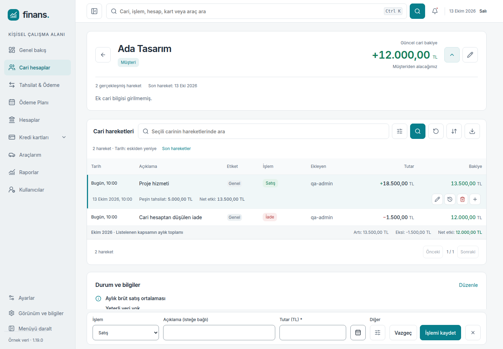
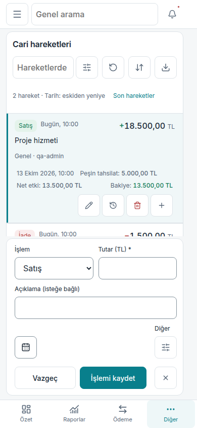
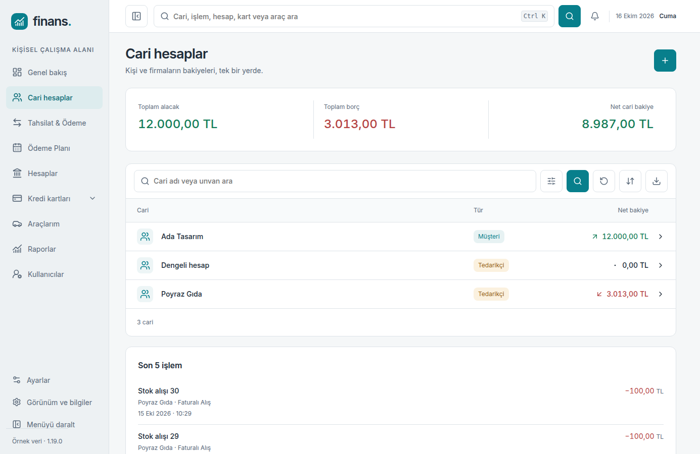

# 1.19.0 — Çalışan sürüm test raporu

16 Kasım 2026. Onaylı kapsam: [SURUM-1.19.0.md](SURUM-1.19.0.md).

- Test edilen uygulama commit'i: `b35e564c82c36fae1e61a2370683fd3c55627218`.
- [Başarılı Candidate QA çalışması](https://github.com/emreguler-code/finans-paneli/actions/runs/43885705130): sekiz işin tamamı başarılı.
- Bu rapor ve ekran görüntüleri testten sonra eklendi; uygulama, API, şema ve paket içeriği aynı commit'teki dosyalardır.

| Kontrol                                   | Sonuç                                                    |
| ----------------------------------------- | -------------------------------------------------------- |
| Üretim derlemesi                          | Başarılı                                                 |
| Birim / statik sunum                      | 49 + 4 test başarılı                                     |
| Yeni cari görünümü, Chromium ve WebKit    | Her motorda 73 kontrol başarılı                          |
| Gerçek PHP/MariaDB genel akışları         | 707 kontrol başarılı, tarayıcı çalışma zamanı hatası yok |
| Mobil Chromium ve WebKit                  | Her motorda 71 kontrol başarılı                          |
| Finansal API / migrasyon / yedekleme      | Üç bağımsız iş başarılı                                  |
| Kapsamlı demo ve rapor mutabakatı         | Başarılı                                                 |
| ZIP'ten gerçek kurulum ve arşiv bütünlüğü | Başarılı                                                 |

Yeni görünüm 320, 390, 430, 768, 960, 1385 ve 1920 px genişliklerde test edildi. Genel yerleşim akışları ayrıca 2540 px, kısa ekran ve büyük tutar/uzun unvan örneklerini kapsar. Temel görsel kontrollerde normal hareket, mevcut kabul testlerinde azaltılmış hareket ve özel azaltılmış hareket senaryosu kullanıldı.

## Kontrol edilen yeni davranışlar

- İşlem/Ekleyen ayrı sütunlar, Tutar → Bakiye sırası korunur.
- Seçili masaüstü satırı yaklaşık 96 px; kısmi ödeme/net etki gerektiğinde açıklanır, tutar ve bakiye yinelenmez. Mobilde bakiye bir kez, eylem hedefleri 44 px.
- Tam filtrelenmiş ayın net etkisi sayfa sınırından bağımsız; iptal/plan kayıtları dışarıda. Tarih sınırları, yıl geçişi ve 29 Şubat birim testlerinde doğrulandı.
- ×/+ aynı koordinatta; açılışta form alanına odak verilmez. Gizleme taslağı tutar, gizli taslak da sayfadan ayrılma korumasına dahildir.
- Gerçek PHP'ye ardışık iki kayıt farklı istek anahtarlarıyla birer kez kaydedildi. Önizleme/kısmi ödeme ve düzenlemede mükerrer kayıt kontrolleri başarılı.
- Menü tam/dar/gizli/tam; tercih yenilemede ve boyut değişiminde korunur. Sıralama ikona bağlı, blur yok; Escape/dışarı ve azaltılmış hareket test edildi.
- Mobil Diğer menüsünün işlem formunun altında kalmasına yol açan katman sorunu düzeltildi.
- Gözlemci kullanıcıya işlem formu veya düzenleme eylemi gösterilmez.

## Çalışan uygulamadan ekran görüntüleri

PHP demo verileri sabit 13 Ekim 2026 tarihini kullanır; görseller tasarım çizimi değildir. Cari liste görseli üç bakiye yönünü göstermek için sentetik API fixture'ından alınmıştır.

### Masaüstü — gerçek PHP demo

### Mobil 390 px — gerçek PHP demo

### Cari listesi — kontrollü test verisi

## Paketler ve sınırlar

- `finans-paneli-1.19.0-hosting.zip` SHA-256: `4fc6fed432f6e37b223f4652b7e9a15be37abab89c643b29ea7c2d83fefe3435`.
- `finans-paneli-1.19.0.zip` SHA-256: `fadcd7839c1d5fbba995475a536bf3b7b162d7c89c05797cfd23c49a5d4fc6a6`.
- Paketler veri, yönetici parolası ve config.php içermez; şema 12 korunur.
- Testler izole demo veritabanlarında çalıştı. Kullanıcının canlı hosting'i veya gerçek verileri değiştirilmedi; GitHub Release yayımlanmadı.
- Headless Chromium/WebKit testi fiziksel iOS Firefox testi değildir. Derlemedeki mevcut büyük JS paket uyarısı bu sürümde devam eder; hata değildir.
