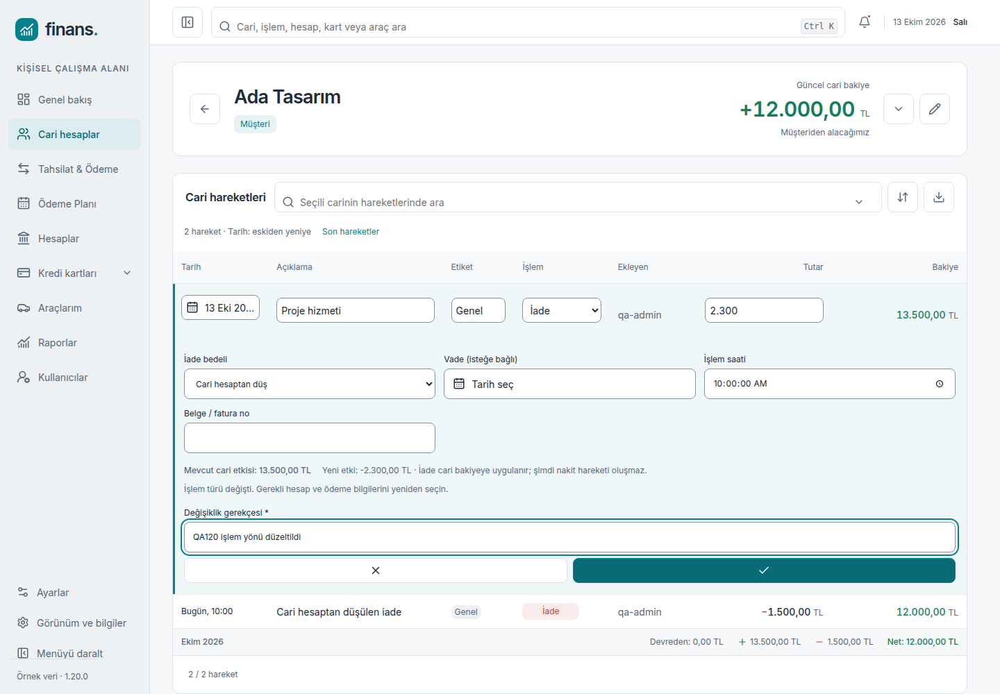
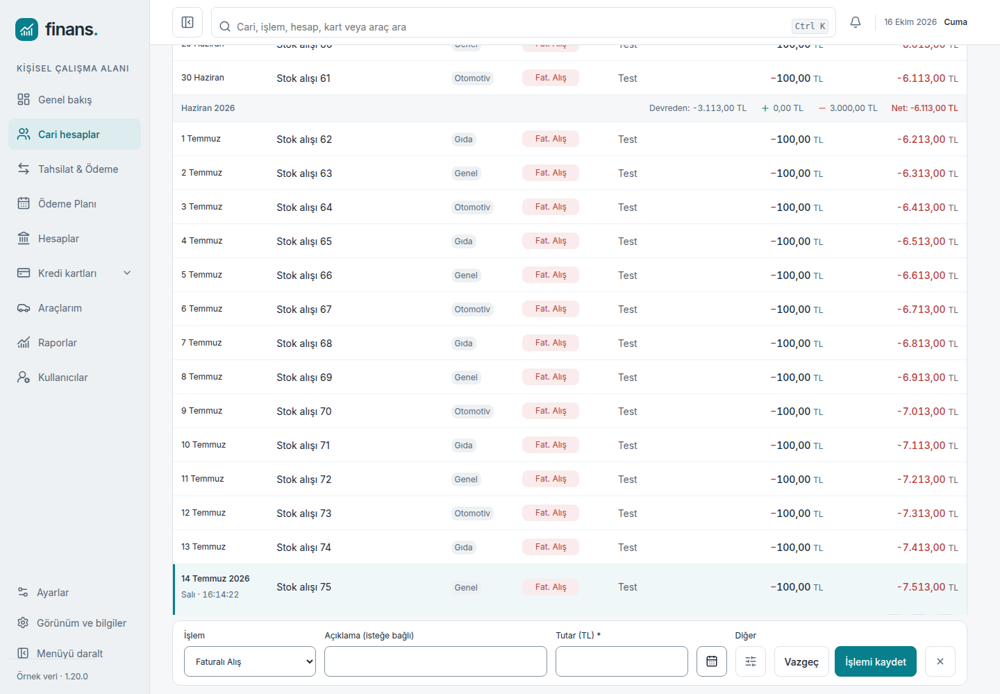
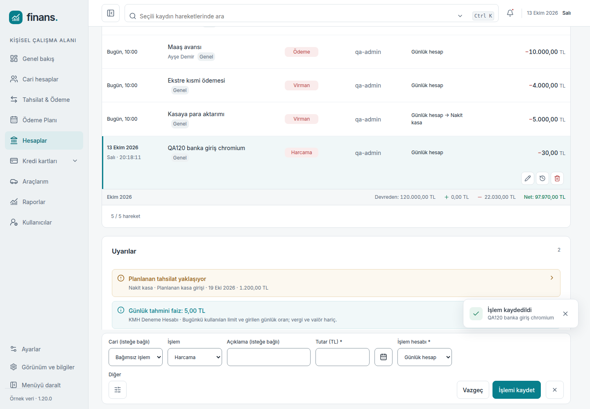
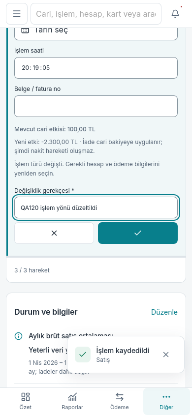

# 1.20.0 test ve görsel kontrol raporu

Test edilen uygulama commit'i: `d009e30665d4a311922ae663eb57f9a7455c73e3`.

[Başarılı sekiz iş grubu ve çalıştırma kayıtları](https://github.com/emreguler-code/finans-paneli/actions/runs/43916737190). [Bölüm bazında uygulama analizi](SURUM-1.20.0.md). [GitHub sürümü](https://github.com/emreguler-code/finans-paneli/releases/tag/v1.20.0).

## Sonuç

| Kontrol | Sonuç |
|---|---|
| Yerel birim/statik worker kontrolleri ve derleme | 57 + 4 kontrol başarılı; üretim derlemesi başarılı |
| Odaklı 1.20 arayüz kabulü | Chromium 43 / WebKit 43 kontrol; çalışma zamanı hatası yok |
| Gerçek PHP/MariaDB masaüstü kullanıcı akışı | Chromium 146 kontrol başarılı |
| Gerçek PHP/MariaDB mobil ve çoklu genişlik kabulü | Chromium 146 / WebKit 145 kontrol başarılı |
| Finansal API | Başarılı |
| Migrasyon / kurtarma | Başarılı |
| Yedekleme / geri yükleme | Başarılı |
| Kapsamlı demo ve rapor mutabakatı | 624 hareket, 29 hafta, 715 bağımsız mutabakat kontrolü başarılı |
| ZIP kurulum ve paket bütünlüğü | Başarılı; iki dağıtım ZIP'i ve SHA-256 doğrulandı |

Sekiz paralel CI işinin tamamı başarılıdır. Mobil kabul betiği aynı test veritabanında iki motoru sırayla çalıştırır; ikinci motor kendi satış test kaydını üretir, önceki motorun değiştirdiği satış için koşullu kontrol sayısı bir eksiktir.

## Kontrol edilen davranışlar

- Son 30 hareketle açılış, önceki kayıtları eklerken görünen satır konumunun korunması; numaralı sayfalamanın kaldırılması.
- Hızlı giriş kapalıyken sıfır yerleşim yüksekliği, + ve × için aynı ekran koordinatı, taslak ve sayfadan ayrılma koruması.
- Arama komutları, kaldırılabilir etiketler, aynı alanda VEYA / alanlar arasında VE, geçersiz komut uyarısı, öneriler, CSV kapsamı.
- Satır içinde tür/tutar düzeltme, zorunlu gerekçe, kaydet/iptal, gerçek API ile eski nakit etkisinin geri alınması ve yeni etkinin uygulanması; logda gerekçe.
- Faturalı/faturasız alış ayrımını değiştirirken uyumlu kısmi ödemenin korunması; uyumsuz tür değişiminde hesap/ödeme seçimlerinin temizlenmesi.
- Banka giriş/çıkış düzeltmesinin mutabakatı; sabit kredi kartı ve nakit hesabının yanlış etkilenmemesi.
- Gerçek ay sonu bakiyesi, filtrelerden ve görüntülenen kayıt sayısından bağımsız devir; aktif satırda tarihin bir kez gösterilmesi.
- Cari, hesap, kredi kartı, tahsilat/ödeme, rapor, ödeme planı ve araç akışları; salt okuyucu izinleri; 320–1920 piksel genişlikler, mobil 44 piksel eylem hedefleri.

## Gerçek test ekranları

Ekranlar çalışan uygulamanın otomatik tarayıcı testlerinden alınmıştır. Yerel Inter, Lucide ikonlar, mevcut turkuaz/yeşil/kırmızı rolleri, tek parça aktif satır ve tablonun tutar/bakiye sırası görsel olarak incelenmiştir.

Ham kabul kayıtları: [odaklı arayüz](evidence/1.20.0/frontend-checks.json), [masaüstü](evidence/1.20.0/browser-checks.json), [mobil](evidence/1.20.0/mobile-checks.json).

## Sınırlar

Satırlar aşamalı olarak DOM'a eklenir; mevcut state API tüm veriyi yüklemeye devam eder. Sunucu tarafında ağ bazlı sayfalama bu sürümün kapsamı değildir. WebKit testi fiziksel iPhone/iOS Firefox testi sayılmaz. Önceden mevcut büyük JavaScript paketi uyarısı sürer; derlemeyi engellemez. Testler izole demo verisi üzerinde yapılmıştır; canlı hosting kurulumu ve gerçek veri değişikliği yapılmamıştır.

## Yayın doğrulaması

1.20.0, ana dala PR #12 ile birleştirildi ve GitHub Release olarak yayımlandı. [Yayın koşusunun tüm adımları başarılı](https://github.com/emreguler-code/finans-paneli/actions/runs/43918156586). İki ZIP ve iki SHA-256 dosyası Release üzerinde mevcut; yayımlanan ZIP özetleri yukarıdaki kabul koşusunda doğrulanan paketlerle birebir aynıdır. [Yayın ve paket makbuzu](evidence/1.20.0/release-receipt.json). Hosting'e canlı kurulum yapılmadı.
