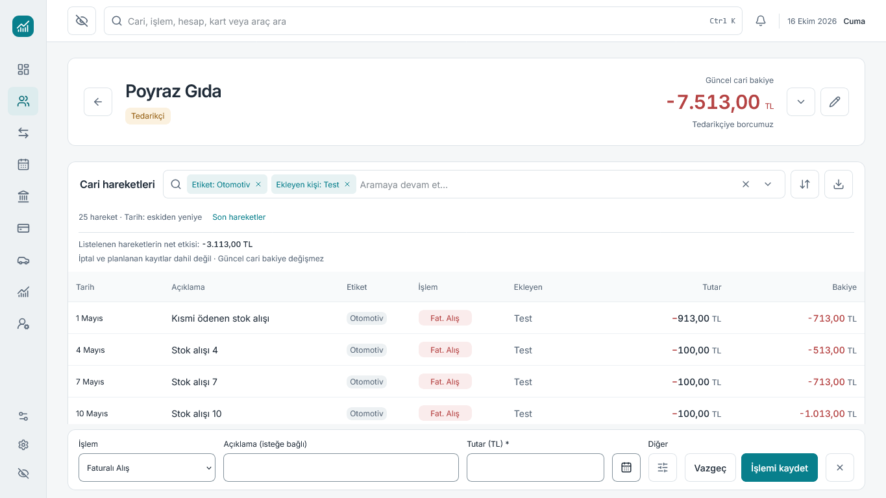
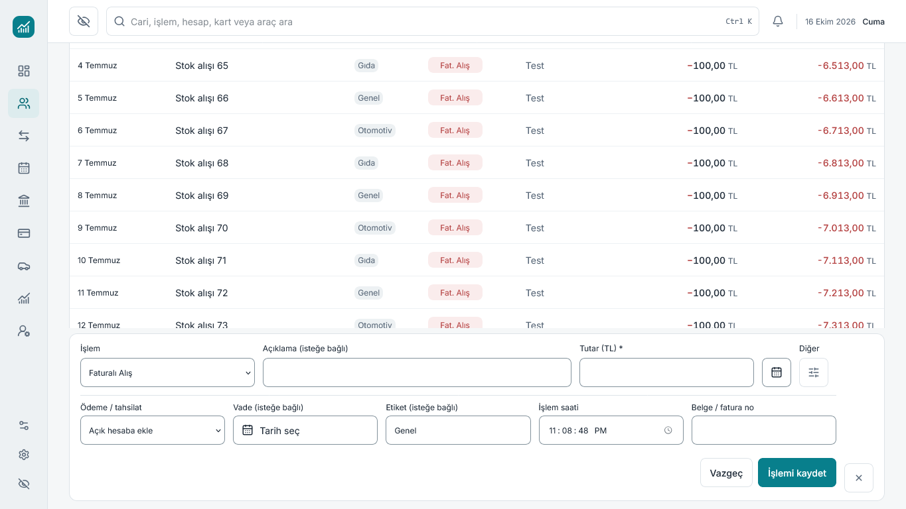
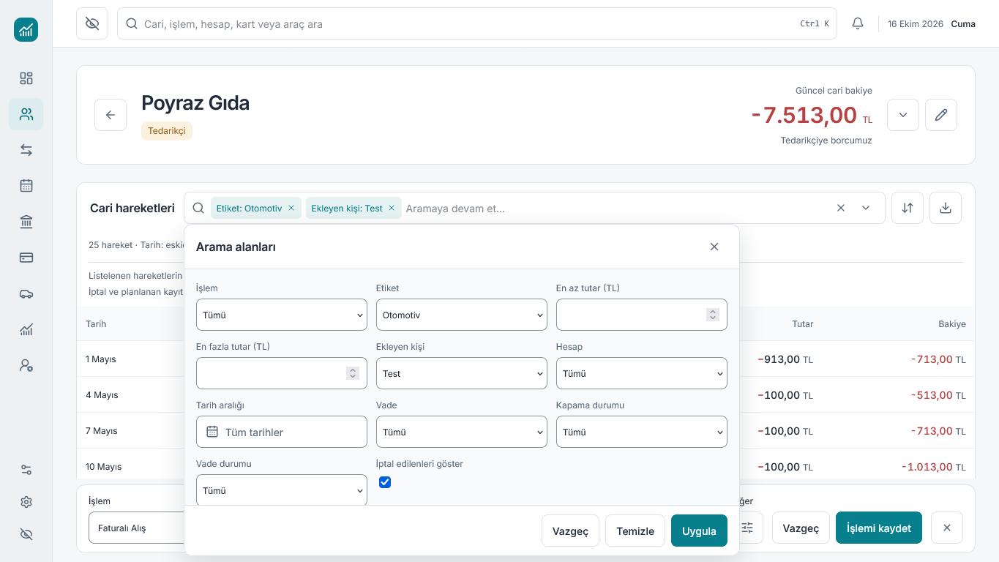
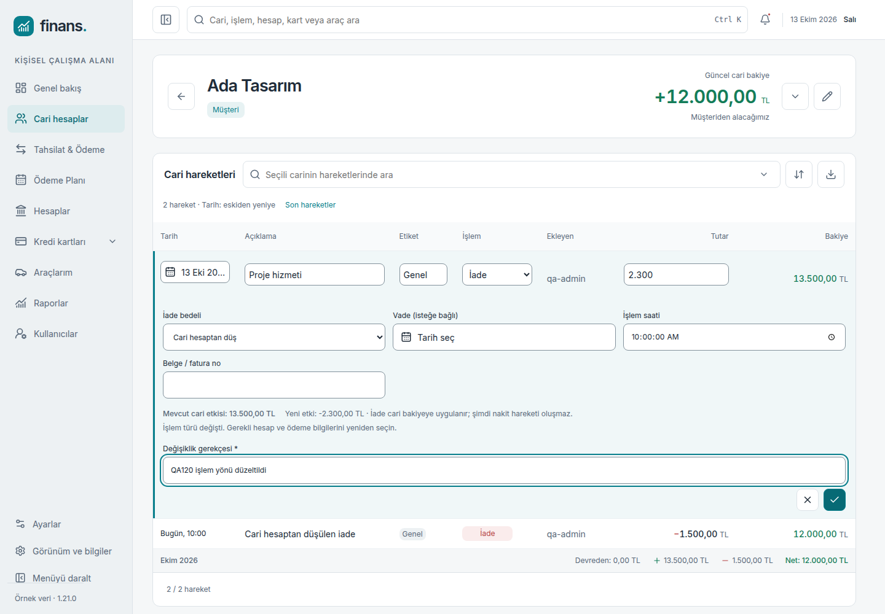
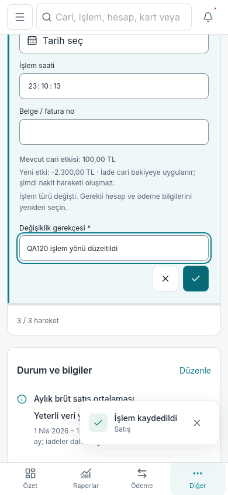

# 1.21.0 — Kabul ve kod sağlığı raporu

Test edilen kaynak commit'i: `31a7342d98cd489025e48905bbe2e6a543d3da03`. [Dokuz başarılı iş grubu](https://github.com/emreguler-code/finans-paneli/actions/runs/43946471985). Sonraki rapor/ekran commit'i uygulama kodunu değiştirmez.

## Sonuçlar

| Kontrol | Sonuç |
|---|---|
| ESLint 10 / React Hooks / kullanılmayan kod | Src genelinde hata yok; kullanılmayan import/değişkenler temizlendi |
| Stylelint / biçim | CSS özellik/birim/renk/tekrar kontrolleri ve ortak bileşen biçimi başarılı |
| npm audit | Tüm bağımlılıklarda raporlanan açık: 0 |
| Birim ve statik worker | 57 + 4 test başarılı |
| Linux sentetik arayüz / geometri | Chromium 111, WebKit 111, Firefox 111; çalışma zamanı hatası 0 |
| Windows sentetik arayüz / geometri | Firefox 111, Chromium 111; çalışma zamanı hatası 0 |
| Gerçek PHP/MariaDB masaüstü kullanıcı akışı | Chromium 146 kontrol, hata 0 |
| Gerçek PHP/MariaDB mobil / çoklu genişlik akışı | Chromium 146, WebKit 145, Firefox 145; hata 0 |
| API / migrasyon / yedekleme | Üçü de başarılı |
| Kapsamlı demo ve raporlar | 624 hareket, 29 hafta, 715 bağımsız mali mutabakat; arayüz ve rapor kontrolleri başarılı |
| Paketleme / ZIP kurulum | Başarılı; iki ZIP ve SHA-256 doğrulandı; özel config/oturum dosyası yok |

İkinci/üçüncü motor aynı izole veri üzerinde çalışırken önceki motorun değiştirdiği satış yerine yeni test satışı oluşturur; koşullu mali kontrol sayısı bu yüzden bir eksiktir.

## Görsel ve davranış kabulü

1. Sayfa ve tablo geçişleri: 1024, 1280, 1365, 1440, 1564, 1565, 1600, 1920, 2048 CSS px; tam/dar/gizli menüde yan sütun yalnız ledger en az 880 px kalıyorsa yan yana. Alt sütun tam genişlikte. Önceki 320–1920 kabulü de sürer.
2. Arama: iki kaldırılabilir filtre etiketi tek satır okunaklı; ikon merkezi ölçülür. En fazla 760x540 px panel, kaydırılabilir gövde ve içeride erişilebilir eylemler.
3. İşlem alanı: açık ek seçenekler tüm dock genişliğini kullanır; içerik bölgesine alan kalır. Kapalı formun Kaydet düğmesi tutar alanıyla aynı hizada. Gizli dock sıfır yükseklik; yüzer + aynı konumda.
4. Satır düzenleme: 320/768/1365/2048 genişliklerinde kaydet/iptal 36–44 px ikon; taşma yok, tam tarih bir kez, mevcut reason/version/atomik kayıt korunur.
5. Son ay satırı: ana kaydırma alanına tam olarak getirilebilir. Zoom eşdeğeri 1092x614, 910x512, 683x384, 320x568 alanlarda taşma/gizleme kontrolü ve 1,5 ölçekli 1365x700 görseller.

Aşağıdaki görüntüler çalışan uygulamadan alınmıştır; üretim kullanıcısının ekranı veya çizilmiş taslak değildir. Son görsel inceleme arama ikonlarını/etiketlerini, ek alan oranlarını, eylem boyutlarını ve masaüstü/mobil tutarlılığını doğruladı. Görsel incelemede yakalanan son Kaydet hizası için ayrıca geometri testi eklendi.

Ham kayıtlar: [Windows](evidence/1.21.0/windows-checks.json), [Linux geometri](evidence/1.21.0/frontend-checks.json), [gerçek masaüstü](evidence/1.21.0/browser-checks.json), [gerçek mobil](evidence/1.21.0/mobile-checks.json), [bağımlılık taraması](evidence/1.21.0/dependency-audit.json).

## Standart ve bakım kararları

ESLint/Stylelint/biçim denetimleri npm test içindedir; GitHub yayınında npm audit orta ve üstü açıkta durdurur. Windows kabulü başarılı olmadan yayın işi başlamaz. Vite 6.4.6, mevcut desteklenen serinin güvenlik yamasıdır; gereksiz ana sürüm geçişi yapılmadı. Kaynaklarda LF satır sonu işletim sistemleri arasında sabitlendi. [Kod kalite politikası](KOD-KALITESI.md) ve [sürüm kapsamı](SURUM-1.21.0.md).

## Sınırlar

Bu kabul tüm olası ekranları sonsuza kadar hatasız kılma garantisi değildir. Windows testleri kullanıcının kendi Firefox profili değil otomasyon tarayıcılarıdır. Daraltılmış etkin viewport ve deviceScaleFactor testi gerçek browser-chrome zoom kontrolü değildir. Fiziksel iOS cihazında test yapılmadı. Eski CSS'in bütünü kullanılmayan koddan arındırılmış sayılmaz; bu sürüm sorunlu ortak bileşen sahiplerini ve denetlenebilir kaynak tekrarlarını temizler. Üretim JS paketindeki mevcut büyük chunk uyarısı sürer; derleme başarılıdır. Ağ tabanlı sayfalama/şema değişmedi. Canlı hosting'e kurulum ve gerçek veri işlemi yapılmadı.

## Yayın doğrulaması

PR #13 ana dala birleştirildi. [1.21.0 GitHub Release](https://github.com/emreguler-code/finans-paneli/releases/tag/v1.21.0) taslak değildir; iki ZIP ve iki SHA-256 dosyası mevcuttur. [Yayın koşusu](https://github.com/emreguler-code/finans-paneli/actions/runs/43947649464) Windows kapısı ve tüm Linux kabul adımlarıyla başarılıdır. Yayımlanan ZIP özetleri test edilen paketlerle birebir aynıdır. [Yayın makbuzu](evidence/1.21.0/release-receipt.json). Canlı hosting kurulumu yapılmadı.
