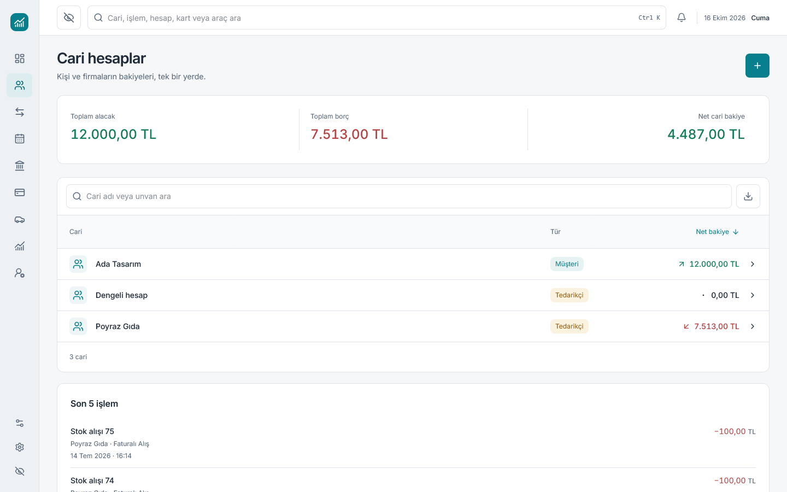
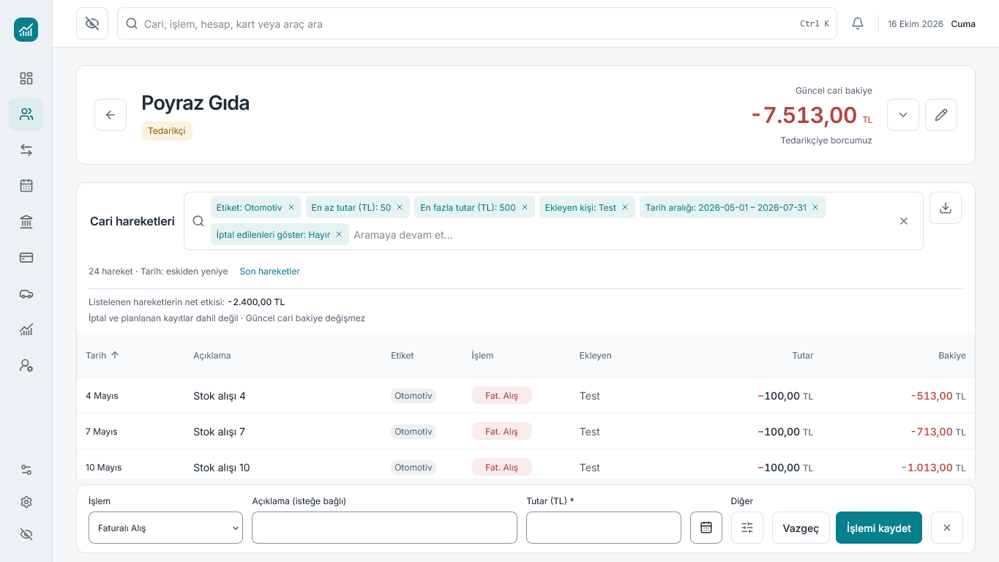
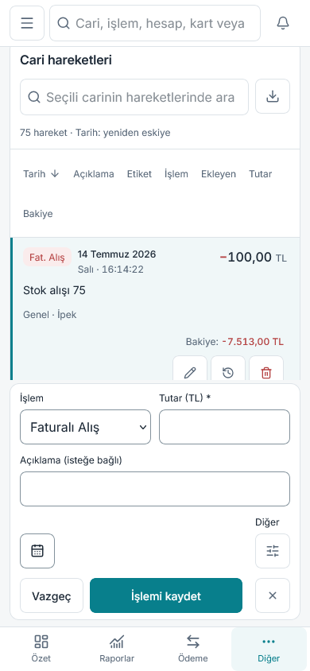
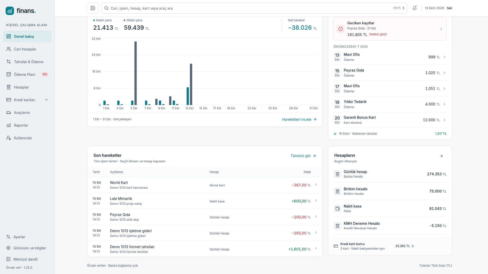

# 1.22.0 — Kabul raporu

Test edilen uygulama commit'i: `1204b7b7fe248b9b59fe8ea0674d22e839620fcb`. [Dokuz başarılı iş grubu](https://github.com/emreguler-code/finans-paneli/actions/runs/44058031179). Sonraki belge ve ekran commit'i uygulama kodunu değiştirmez.

| Kontrol | Sonuç |
|---|---|
| ESLint / Stylelint / biçim / derleme | Başarılı |
| Birim / statik worker | 63 + 4 başarılı |
| npm audit | Raporlanan açık 0 |
| Linux sentetik arayüz / geometri | Chromium, WebKit, Firefox: motor başına 130 kontrol; hata 0 |
| Windows sentetik arayüz / geometri | Firefox, Chromium: motor başına 130 kontrol; hata 0 |
| Gerçek PHP/MariaDB masaüstü | Chromium kabulü başarılı |
| Gerçek PHP/MariaDB mobil | Chromium 146, WebKit 145, Firefox 145 kontrol; hata 0 |
| API / migrasyon / yedekleme | Başarılı |
| Kapsamlı demo ve mali rapor mutabakatı | Başarılı |
| Paketleme / izole ZIP kurulum | Başarılı; iki ZIP ve SHA-256 doğrulandı |

## Kabul edilen davranış

- Arama çubuğunda ayrı filtre formu/ok yoktur. Tarih, tutar, etiket, ekleyen ve iptal komutları birlikte çip olur; hatalı komut sonuçları kısmen değiştirmez. Türkçe sayı/tarih ve tırnaklı değerler doğrulanır; tırnaklı düz açıklama metni de korunur.
- Yedi hareket sütunu yön değiştirerek sıralar; yalnız etkin başlıkta ok/aria-sort vardır. Türkçe ekleyen sırası görünür 30 kayıtla sınırlanmaz. Tutar işaretli sayıdır; kayıtlı bakiyeler sıralama sırasında yeniden hesaplanmaz.
- Mobilde başlıklar doğrudan kullanılabilir, dar alanda sarılır. Cari dizinde arama/CSV aynı hizada, net bakiye sayısal sıralanır.
- 320–2048 CSS px, eşik çevreleri, üç sidebar modu, kısa pencereler ve ölçekli görseller mevcut kabul akışına dahildir. Arama ikon/çip geometrisi, ek işlem alanı, satır içi düzenleme ve taslak koruması gerileme testlerinden geçer.
- Çalışan genel bakış ekranında panel boşlukları ve tek satır tutar/TL; Windows Firefox ekranında arama çipleri, sütun okları ve cari liste hizası ayrıca görsel incelendi.

[Windows kontrolleri](evidence/1.22.0/windows-checks.json) · [Linux kontrolleri](evidence/1.22.0/linux-checks.json) · [Gerçek API mobil kontrolleri](evidence/1.22.0/mobile-checks.json) · [Bağımlılık denetimi](evidence/1.22.0/npm-audit.json)

## Sınırlar

Fiziksel iPhone/iOS, kullanıcının kişisel Firefox profili veya gerçek tarayıcı yakınlaştırması test edilmedi. Ölçekli/etkin viewport kontrolleri bunların yerine geçmiş sayılmaz. Son 30 kayıt istemci tarafında kademeli gösterilir; sunucu sayfalaması değildir. Vite büyük JS parçası uyarısı sürmektedir; bu sürümde bağımlılık veya mali model yeniden yazımı yapılmadı. Şema 12, gerçek veriler ve canlı hosting değişmedi.
