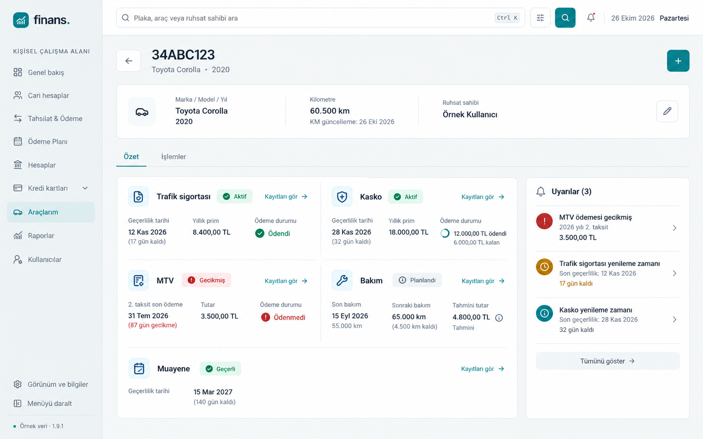
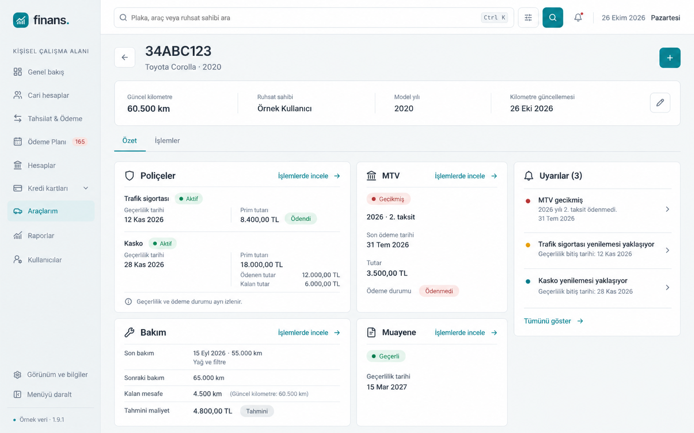
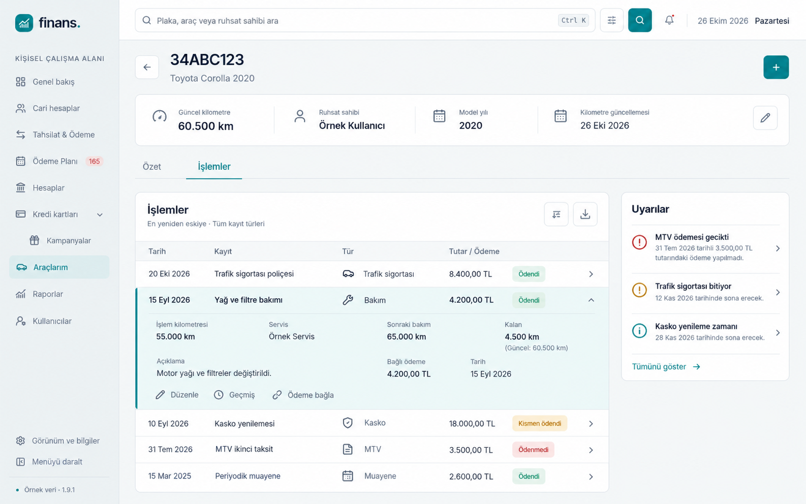

# Araçlarım — Özet / İşlemler tasarım önerileri

**Güncel durum — 1.10.0:** Kullanıcı 2 numaralı Poliçeler özeti ile 3 numaralı İşlemler görünümünü onayladı; birlikte uygulandı. Aşağıdaki ilk değerlendirmeler karar geçmişidir.

26 Ekim 2026. Kullanıcının yeni istediği araç detay yapısı ve Product Design yaklaşımıyla hazırlanan görsel değerlendirme. Uygulama kodu/sürüm/paket değiştirilmedi; görsel stil seçimi henüz yapılmadı. İlk iki görsel Özet sekmesine iki yaklaşım, üçüncüsü aynı akışın İşlemler sekmesindeki açılır satır durumudur. Üçüncü görsel tek başına ilk ikisinin yerine geçmez; bunlarla birlikte değerlendirilebilir.

## Kullanıcının istediği akış

Araç kartı → varsayılan Özet → istenirse İşlemler.

- **Özet:** Poliçe, MTV, bakım ve diğer mevcut araç kayıt türlerini kendi özet içeriğiyle grid bölmelerde gösterir.
- **İşlemler:** Trafik sigortası, kasko, bakım, MTV ve muayene kayıtları aynı kronolojik listede karışık görünür. Satıra tıklanınca o türün detay alanları satır içinde açılır; tür başına ayrı gezinme sekmesi olmaz.
- Yalnız iki üst sekme bulunur: Özet / İşlemler. Trafik sigortası/Kasko/MTV/Bakım/Muayene artık ek navigasyon sekmeleri değildir.

## Açık kaynak incelemesi ve çıkarımlar

Bu kısa taramada kaynakların kamuya açık HTML metinleri okundu; oturum içi uygulamalar veya bütün ürün akışları tarayıcıyla denetlenmedi. Bu bir kullanıcı testi veya yaygınlık araştırması değildir.

| Kaynak | Doğrudan gözlenen | Bizim tasarım için çıkarım |
|---|---|---|
| [PistonHeads Readers’ Cars](https://www.pistonheads.com/gassing/forum.asp?h=0&f=47) | Marka/model etrafında açılmış, çok sayfaya uzanan araç sahibi konu başlıkları ve güncellenen tartışma listesi. | Araç merkezli bir dosya ve zaman içinde biriken kayıt günlüğü anlaşılır olabilir. Forumun sosyal alanlarını veya görsel dilini taşımak gerekmez. |
| [Drivvo bakım takibi](https://www.drivvo.com/en/vehicle-maintenance/) | Yapılan bakımın tarih, kilometre ve tutarı; geçmiş ile yaklaşan bakımın birlikte takibi; tarih veya kilometreye bağlı hatırlatmalar açıkça açıklanıyor. | Güncel durum özeti ile kayıt geçmişini ayırmak; bakımda tarih/kilometre bilgisini korumak uygun. Tekrarlama/otomatik bakım tahmini gibi yeni işlevler kendiliğinden kapsamımıza eklenmez. |
| [Fuelly](https://www.fuelly.com/) | Araç ekleme, tekrar eden yakıt kayıtları ve araç bazlı raporlarla zaman içindeki tüketim/giderleri takip etme yaklaşımı açıklanıyor. | Tek araca bağlı düzenli kayıt ve geçmiş görünümü yararlı. Yakıt modülü veya km başı maliyet mevcut veri olmadan eklenmez. |

Spritmonitor ana sayfası HTTP 403 verdi; o kaynak üzerinden bulgu çıkarılmadı. Kaynaklar kullanıcı tarafından şart koşulmuş erişim gereksinimleri değildir; öneri erişilebilen üç kaynak ve mevcut uygulama üzerinden hazırlanmıştır.

## Görseller

| 1 — Durum özeti | 2 — Poliçeler bir arada | 3 — Birleşik işlem günlüğü |
|---|---|---|
|  |  |  |

### İlk özet yaklaşımı

Tek beyaz ana çerçeve içinde Trafik sigortası, Kasko, MTV, Bakım ve Muayene bölmeleri. Mevcut Finansal görünümdeki bölümlenmiş yüzey kararına en yakın seçenek. Kategorilerin ayrı durum ve tarihleri ilk bakışta okunur. Asistanın önerdiği özet bu yaklaşımdır; kullanıcı seçimi değildir.

### İkinci özet yaklaşımı

Trafik sigortası ve kasko Poliçeler bölmesinde; MTV, Bakım ve Muayene diğer üç grid bölmesinde. Poliçelerin birlikte taranması daha kolay; aynı bölmedeki iki farklı sigortanın geçerlilik ve ödemeleri ayrı tutulmalı. Görseldeki bağımsız dış kutular nihai uygulamada ortak tek yüzey/ayırıcı ilkesiyle uyarlanabilir.

### İşlemler yaklaşımı

Türleri karışık tek liste. Örnek sıralama işlem tarihine göre en yeniden eskiye. Bakım satırı seçilince kilometre, servis, sonraki bakım, açıklama, tutar/bağlı ödeme ve ilgili eylemler tek yüzey içinde açılıyor. Poliçe satırında şirket/poliçe no/geçerlilik; MTV satırında dönem/taksit/vade gibi türüne uygun alanlar gösterilebilir. Her kayıt için bütün ayrıntıları sürekli açık tutmak yerine mevcut satır genişletme dili kullanılır.

## Önerilen ortak kurallar

- Başlık/geri/yeni kayıt üstte; araç kimliği, güncel kilometre ve ilgili özet ayrı ortak bantta.
- Sıralama/indirme gibi içerik araçları ilgili listenin içinde kalır; başlıktaki ekle düğmesinin yanına taşınmaz.
- Özet bölmesindeki “Kayıtları gör”/“İşlemlerde incele” bağlantısı yeni pencere yerine İşlemler sekmesini ilgili tür filtresiyle açabilir. Filtre görünür ve temizlenebilir olmalı. Bu bir asistan önerisidir.
- Bildirimler en fazla 5 kayıttır; “Tümünü göster” merkezi sayfaya araç/ilgili araç filtresiyle gider. Ortak kırmızı kritik, amber dikkat, teal bilgi rolleri kullanılır.
- Geçerlilik ile ödeme durumu ayrıdır. Aktif kaskonun ödenmemiş prim taksidi olabilir. İşlem tutarı, ödenen ve kalan birbirine karıştırılmaz.
- Araç kaydı finansal hareket değildir. Mevcut ödeme bağlantısı korunur; kayıt listede veya özette gösterildiği için ikinci gider oluşmaz. Tahmini bakım bedeli gerçek ödeme sayılmaz.
- Kilometreye bağlı bakım tarihi olmayan eksik kayıt gibi sunulmaz; kayıtlı sonraki km ve güncel km üzerinden kalan mesafe gösterilebilir. Üreticiden otomatik takvim/arıza tahmini gibi işlevler eklenmez.
- Açılan satır ile eylemleri tek yüzey olmalıdır; içeride kopuk bir eylem şeridi oluşturulmaz. Üçüncü görseldeki ince satır çizgileri bu ortak kuralın yerini almaz.
- Nihai tipografi, renkler, ikonlar, 1,9:1 sütun ve boşluklar mevcut global ilkelere uyar. Görsellerdeki gün sayıları, veriler ve ölçüler temsili; kesin tarih hesapları mevcut yardımcılarla yapılır.
- Özet finansal filtre sonucu ile araçtaki güncel durumu karıştırmamalı; uygulamada kapsam açık belirtilmeli.

**Öneri:** İlk özet yaklaşımı + üçüncü görseldeki İşlemler etkileşimi. İkinci görseldeki Poliçeler gruplaması tercih edilirse aynı akış içinde uyarlanabilir. Kullanıcı değerlendirmesi bekleniyor; kodlama/yayın yok.
