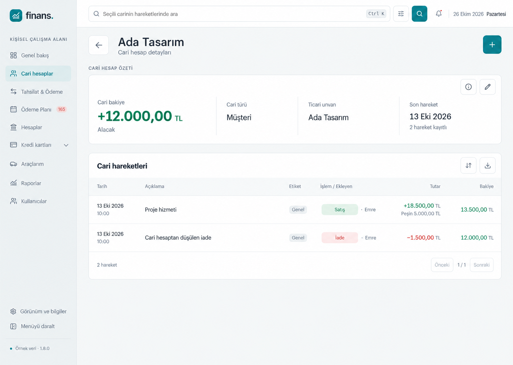
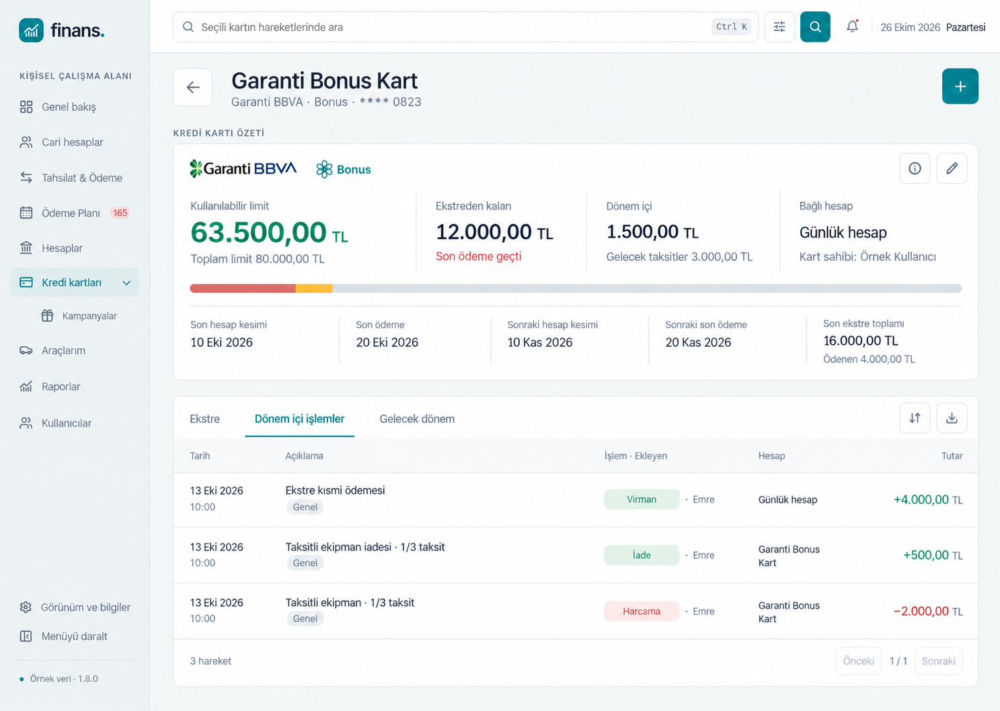

# Cari ve kredi kartı — ortak detay tasarımı

26 Ekim 2026. Bu taslakların ikisi de kullanıcı tarafından onaylandı; 1.9.0 ortak detay tasarımının referanslarıdır. Görsellerdeki bilgiler örnek senaryodur.

| Cari hesap detayı | Kredi kartı detayı |
|---|---|
|  |  |

## Aynı kalan tasarım kuralları

- Sayfa başlığı ve geri dönüş kutunun dışında; yeni işlem + düğmesi başlık satırının sağında.
- Altında içerik genişliğinde tek bir beyaz bilgi bandı; ince iç ayırıcılar, aynı kenarlık, köşe, tipografi ve boşluk dili.
- Bilgi ve düzenleme ikonları kayıt özetinin kendi üzerinde. Yeni işlem düğmesi özetin veya hareket tablosunun içine tekrar konmuyor.
- Ortak üst arama; hareket alanında ilgili sıralama ve indirme araçları. İlgisiz sağ sütun veya ek metrik kutuları eklenmiyor.
- Alt menüler başlangıçta kapalı. Kredi kartı ekranında üst menü açık olduğundan Kampanyalar alt öğesi görünür; cari ekranında kapalıdır.

## İçeriğe bağlı farklar

| Konu | Cari hesap | Kredi kartı |
|---|---|---|
| Ana değer | Cari bakiye ve Alacak/Borç anlamı | Kullanılabilir kredi limiti; banka/kasa nakdi değildir |
| Diğer alanlar | Tür, ticari unvan, son hareket | Ekstre kalanı, dönem içi ve gelecek taksitler, bağlı hesap |
| Tarihler | Son hareket | Mevcut ve sonraki kesim/son ödeme tarihleri ayrı |
| Ekstre karşılaştırması | Bu bağlamda yok | Son ekstre toplamı ile kalan borç ayrı gösterilir |
| İç yoğunluk | Daha az alan, tek bilgi sırası | Aynı dış kutuda ek tarih/bilgi satırı ve limit kullanım barı |
| Hareket alanı | Cari hareketleri | Ekstre / Dönem içi işlemler / Gelecek dönem sekmeleri |
| Tablo | Cari tutar ve bakiye sütunları | Kredi kartının kendi sütunları; cari bakiye sütunu kopyalanmaz |

## Örnek kredi kartı senaryosu

Görselin tarih dayanağı 26 Ekim 2026 Pazartesi; 13 Ekim işlemleri geçmiş kayıtlardır. Örnek toplam limit 80.000 TL, kalan ekstre 12.000 TL, dönem içi 1.500 TL ve gelecek taksitler 3.000 TL ise kullanılabilir limit 63.500 TL'dir. Son ekstre toplamı 16.000 TL'den 4.000 TL ödeme düşülmesi 12.000 TL kalanı açıklar; bu toplam ikinci kez borca eklenmez. Bağlı hesap örnek olarak açıkça Günlük hesap seçilmiştir; banka adından tahmin veya otomatik ödeme talimatı anlamına gelmez.

Limit kullanım barının çizimi görsel taslakta temsilidir; uygulamada segmentlerin oranı ve renkleri mevcut limit hesaplaması ve ortak tasarım kurallarından üretilecektir.

Bu karşılaştırmanın amacı her sayfayı aynı sayıda hücreye zorlamak değil, aynı başlık → bilgi bandı → hareketler sırasını ve görsel hiyerarşiyi korumaktır. Kredi kartının daha yoğun bilgileri tek kutunun içinde gruplanır; farklı bir kart sistemi oluşturulmaz. Kesin alan sırası ve yoğunluğu kullanıcı değerlendirmesine tabidir.
