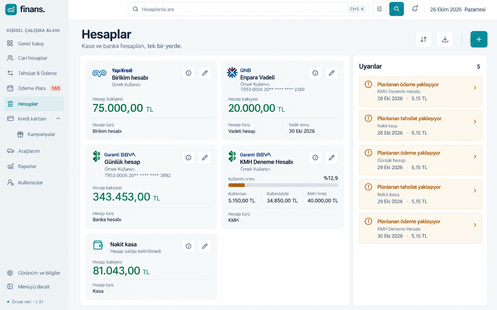

# Hesaplar — ana içerik kutusu ve kart stili denemeleri

26 Ekim 2026. Kullanıcının istediği üç görsel taslaktır; çalışan uygulama kodu değiştirilmedi. Görsel sırası, sohbette görüntülenen sonuç sırasıyla aynıdır. Taslaklarda tutarlar, banka işaretleri ve uyarı içerikleri temsilidir; muhasebe/hesaplama değişikliği veya yeni banka logosu kararı değildir.

## Ortak kararlar

- “Hesap listesi” ikinci başlığı kaldırılır.
- Sayfaya ait sıralama, indirme ve gerekli araç ikonları başlık satırında toplanır. İnce dikey ayraçtan sonra yeni kayıt/işlem ekleme (+) düğmesi en sağda kalır. Bu düzen diğer sayfalarda da ortak tasarım kuralı olarak uygulanmak üzere kaydedildi.
- Hesap kartlarının alanı tek bir ana içerik kutusuyla tanımlanır; hesaplar bu kutunun içinde bölümlenir.
- Kayda özgü bilgi/düzenleme ikonları ilgili kartın kendi üzerinde kalır.
- Inter, Sade Netlik renkleri, 44 px eylemler, ortak boşluk ölçeği, eşit kart yükseklikleri ve hizalı bilgi alanları esas alınır. Sağ uyarı alanında 1,9:1 ana/sağ sütun referansı korunur.
- Kullanıcı stil seçmeden arayüz uygulanmaz ve yeni sürüm yayımlanmaz.

## Görseller

| 1 — Bölümlü yüzey | 2 — Yumuşak kartlar | 3 — Yatay kartlar |
|---|---|---|
|  |  |  |

### 1 — Bölümlü yüzey

Tek beyaz ana panel; iki sütundaki hesaplar ince ayırıcılarla ayrılır. En az çerçeve kullanan ve en sakin seçenek. Hesapların ayrı tıklanabilir kayıtlar olduğu, uygulamada odak/üzerine gelme durumlarıyla netleştirilmeli. Son kasa bölümü tam satırdır; tek başına kalan kaydın genişlemesi bu seçeneğin bilinçli varyasyonudur.

### 2 — Yumuşak kartlar — önerilen

Tek beyaz ana panelin içinde hafif porselen zeminli hesap kartları. Hesapların ayrı kimliği okunur; kendi ikon grupları üst sağda kalır. Eşit yükseklik ve aynı kimlik → bakiye → tür/vade sırası kolay standartlaştırılır. Mevcut kart dilinin devamı olduğu için ortak hesap/kredi kartı düzenine uyarlamaya en uygun seçenek. Bu öneri henüz kullanıcı seçimi değildir.

### 3 — Yatay kartlar

Tek ana panel içinde tam genişlikte yatay hesap kartları. Kimlik, tutar, tür/vade ve yerel eylemler yan yana; çok hesap olduğunda daha hızlı taranır, büyük tutar ve uzun adlar daha fazla yatay alan bulur. Dar ekranda alanlar kart içinde alt alta geçmelidir.

Üçüncü görselin üst araç grubu ana sütunun sağına çizilmiştir; kullanıcı kararına uygun uygulamada sayfa başlığının tam genişliğinin en sağına hizalanmalıdır. Üretilen görsellerin oranları yaklaşık görsel fikirlerdir; kesin uygulama ölçüsü ortak 1,9:1 ve mevcut tokenlardır.

## Finansal anlamlar

KMH limiti nakit bakiyesi değildir. Kullanılan/kullanılabilir limit ve varsa günlük faiz ayrı anlamlarını korur. Vade yalnız ilgili hesap türünde gösterilir. IBAN örnekleri maskelidir. Uyarı örneklerinin metin ve tutarları görsel yerleşim içindir; gerçek uygulama mevcut doğrulanmış verileri kullanacaktır.
