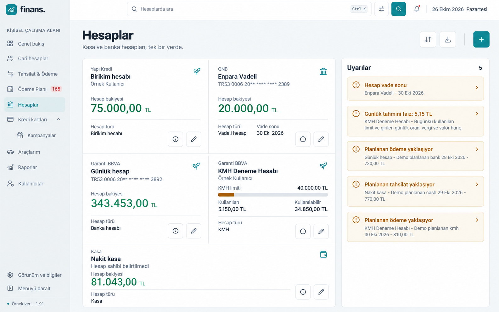
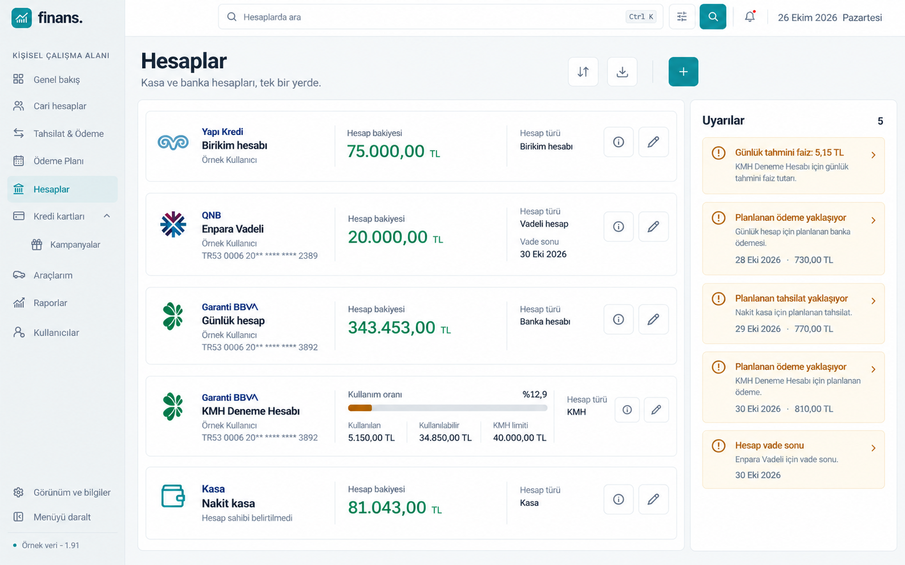

# Hesaplar — ana içerik kutusu ve kart stili denemeleri

26 Ekim 2026. Kullanıcının istediği üç görsel taslaktır; çalışan uygulama kodu değiştirilmedi. Görsel sırası, sohbette görüntülenen sonuç sırasıyla aynıdır. Taslaklarda tutarlar, banka işaretleri ve uyarı içerikleri temsilidir; muhasebe/hesaplama değişikliği veya yeni banka logosu kararı değildir.

**Kullanıcı seçimi: 3 — Yatay kartlar onaylandı.** Görsel yerleşim referansıdır; nihai uygulamada mevcut global yazı tipi, ölçü ve oran kararları korunacaktır. Not aşaması sürüyor; kodlama/yayın talimatı verilmedi.

## Ortak kararlar

- “Hesap listesi” ikinci başlığı kaldırılır.
- **Son karar:** Kullanıcı sıralama/indirme araçlarını yeni işlem düğmesinin yanına taşıma kararını iptal etti. Araçlar ilgili içerik alanında kalır; görsellerdeki üst araç grupları uygulanacak tasarım şartı değildir.
- Hesap kartlarının alanı tek bir ana içerik kutusuyla tanımlanır; hesaplar bu kutunun içinde bölümlenir.
- **Son karar:** Hesap/kredi kartı liste özetlerinde bilgi/düzenleme ikonları kaldırılır; işlevler detay açıldıktan sonra erişilebilir kalır. Görseldeki liste ikonları uygulanmayacaktır.
- Inter, Sade Netlik renkleri, 44 px eylemler, ortak boşluk ölçeği, eşit kart yükseklikleri ve hizalı bilgi alanları esas alınır. Sağ uyarı alanında 1,9:1 ana/sağ sütun referansı korunur.
- Stil seçildi; kullanıcı notlarını tamamlayıp kodlama/yayın talimatı verdiğinde uygulanacaktır.

## Görseller

| 1 — Bölümlü yüzey | 2 — Yumuşak kartlar | 3 — Yatay kartlar |
|---|---|---|
|  |  |  |

### 1 — Bölümlü yüzey

Tek beyaz ana panel; iki sütundaki hesaplar ince ayırıcılarla ayrılır. En az çerçeve kullanan ve en sakin seçenek. Hesapların ayrı tıklanabilir kayıtlar olduğu, uygulamada odak/üzerine gelme durumlarıyla netleştirilmeli. Son kasa bölümü tam satırdır; tek başına kalan kaydın genişlemesi bu seçeneğin bilinçli varyasyonudur.

### 2 — Yumuşak kartlar — önceki asistan önerisi

Tek beyaz ana panelin içinde hafif porselen zeminli hesap kartları. Hesapların ayrı kimliği okunur; kendi ikon grupları üst sağda kalır. Eşit yükseklik ve aynı kimlik → bakiye → tür/vade sırası kolay standartlaştırılır. Mevcut kart dilinin devamı olduğu için ortak hesap/kredi kartı düzenine uyarlamaya en uygun seçenek. Kullanıcı bu alternatif yerine 3 numaralı tasarımı seçti.

### 3 — Yatay kartlar — kullanıcı tarafından onaylandı

Tek ana panel içinde tam genişlikte yatay hesap kartları. Kimlik, tutar, tür/vade ve yerel eylemler yan yana; çok hesap olduğunda daha hızlı taranır, büyük tutar ve uzun adlar daha fazla yatay alan bulur. Dar ekranda alanlar kart içinde alt alta geçmelidir.

Üçüncü görselin üst araç grubu, son kullanıcı kararı gereği başlığa taşınmayacak; sıralama/indirme ikonları ilgili içerik alanında kalacaktır. Yatay kart/liste düzeninin onayı devam eder. Üretilen görsellerin oranları yaklaşık görsel fikirlerdir; kesin uygulama ölçüsü ortak 1,9:1 ve mevcut tokenlardır.

## Finansal anlamlar

KMH limiti nakit bakiyesi değildir. Kullanılan/kullanılabilir limit ve varsa günlük faiz ayrı anlamlarını korur. Vade yalnız ilgili hesap türünde gösterilir. IBAN örnekleri maskelidir. Uyarı örneklerinin metin ve tutarları görsel yerleşim içindir; gerçek uygulama mevcut doğrulanmış verileri kullanacaktır.

## Sonraki netleştirme: kredi kartları ve liste eylemleri

Kullanıcı, seçilen yatay hesap düzeninin kredi kartlarına da paralel uygulanmasını istedi. Kredi kartının ekstre/limit/dönem bilgileri korunacak. Hem hesap hem kredi kartı liste özetindeki info/düzenle ikonları kaldırılacak; detay ekranında bu işlevler erişilebilir olacak. Görsel referansın ikonları ve üst araç grubu değil, yatay kart/liste yerleşimi seçilmiştir. Not aşaması devam ediyor.
