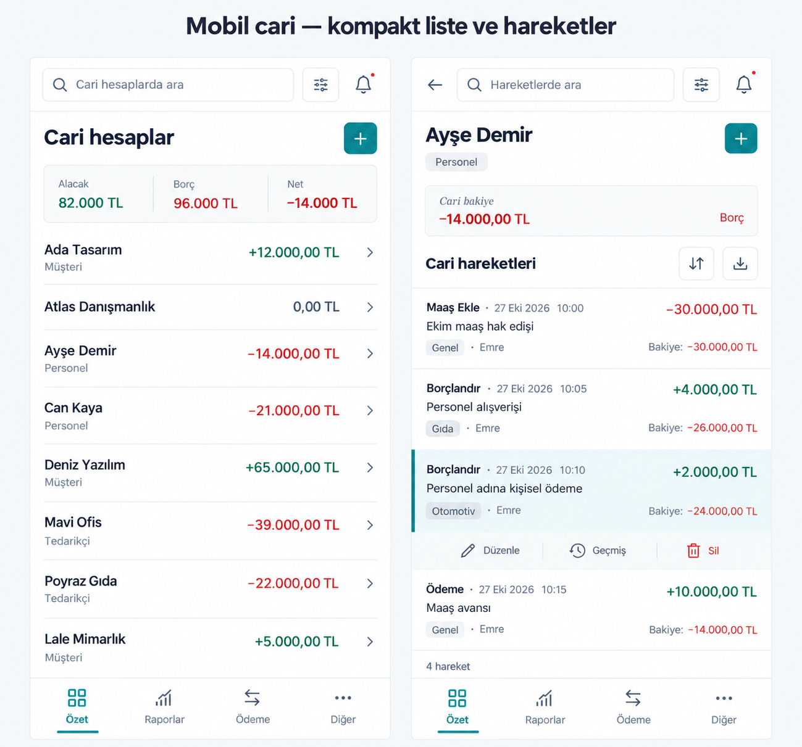

# Mobil cari — kompakt liste ve hareketler

27 Ekim 2026. Kullanıcının mobil örnekleri ve mevcut Finans Paneli tasarım dili temel alınarak görsel değerlendirme için hazırlandı. Uygulama kodu, sürüm ve hosting paketi değiştirilmedi. Görsel henüz uygulama onayı değildir.

- Solda cari adı/bakiye odaklı kompakt liste; farklı olmayan unvan tekrarlanmaz. Alacak/borç/net tek özet yüzeyindedir.
- Sağda her hareket üç kısa bilgi düzeyinde: tür/tarih/tutar, açıklama, etiket/ekleyen/işlem sonrası bakiye. Uzun metin gerektiğinde sarılır.
- Örnekler sentetiktir. −30.000 +4.000 +2.000 +10.000 = −14.000 TL; net cari etkisi ile kalan bakiye ayrı gösterilir. Bu renkler nakit yönünden türetilmez.
- Mevcut Inter, teal, porselen yüzey, çizgi rengi ve 24/16/14/12 px roller nihai uygulamanın referansıdır; görsel üretimdeki optik farklılıklar yeni token değildir.
- Seçili hareket ile eylemler nihai uygulamada kesintisiz tek renk yüzeyinde, arada çizgi olmadan gösterilecek. Taslağın eylem satırındaki ton farkı veya ayraçları bu mevcut kuralı değiştirmez.
- Bu görsel kompakt liste/hareket düzenini karşılaştırmak içindir; bilgi/düzenleme erişimi veya planlanan cari türüne göre bilgi alanlarını kaldırma kararı değildir.
- Hızlı işlem giriş çubuğu eklenmedi. Mobil alt navigasyon korunur; seçili sekme gerçek rotaya göre belirlenir, temsili aktif Özet yeni kural sayılmaz.

Kaynak: kullanıcının paylaştığı mobil cari ekranları; mevcut `docs/TASARIM-ILKELERI.md`. Product Design ideate ile tek taslak, aynı çözümün iki ekranı yan yana üretildi.

Güncel durum: kullanıcı taslağı onayladı; etiket/ekleyen/bakiye satırının yalnız seçili işlemde açılması düzeltmesiyle 1.11.0 uygulandı. Taslakta açık meta satırları nihai kapalı satır tasarımını tanımlamaz.
